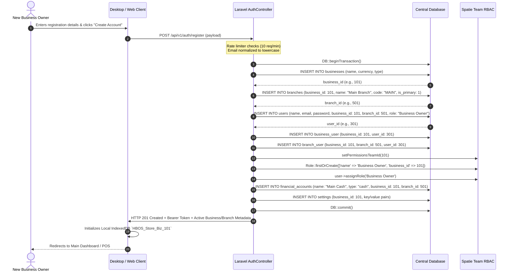

# SKYRASOFT HBOS PUBLIC ACCOUNT ONBOARDING & TENANT PROVISIONING DESIGN
## AUTHORITATIVE ARCHITECTURAL SPECIFICATION FOR SELF-SERVICE REGISTRATION & LIFECYCLE

---

### 1. Product & Business Model Overview

SkyraSoft HBOS is designed for public desktop distribution as a zero-cost software application for retail and wholesale businesses.

- **Pricing Model**: 100% Free of cost for core management and POS operations.
- **Acquisition Model**: Direct public installer download and Microsoft Store distribution.
- **Authentication**: Native email and password authentication. Social login (Google, Microsoft) is deferred and not required for initial distribution.
- **Tenant Isolation**: Every customer self-creates their account, which atomically provisions an isolated business tenant with complete data sovereignty.
- **Role Inheritance**: The registering user is automatically established as the primary `Business Owner` with full administrative authority over their tenant.

---

### 2. Minimal Safe Onboarding Dataset

To minimize registration friction while ensuring data integrity, the public onboarding interface requires only the following minimal attributes:

| Field Name | Type | Validation Rules | Purpose & Transformation |
| :--- | :--- | :--- | :--- |
| `name` | String | `required|string|max:255` | Full legal or display name of the registering business owner. |
| `email` | String | `required|string|email|max:255|unique:users,email` | Global account identity; normalized to lowercase (`strtolower(trim($email))`). |
| `password` | String | `required|string|min:8|confirmed` | Account password; securely hashed using bcrypt (`Hash::make`). |
| `password_confirmation` | String | `required|string|min:8` | Password confirmation matching `password`. |
| `business_name` | String | `required|string|max:255` | Operating business or store trade name. |
| `currency` | String | `nullable|string|max:10` | Default currency symbol/code (defaults to `PKR` if omitted). |

> [!NOTE]
> No speculative onboarding fields (e.g., credit card details, company registration numbers, tax IDs, or phone numbers) are required during initial signup. Additional business profile attributes can be updated post-onboarding in **Settings**.

---

### 3. Step-by-Step Atomic Onboarding Sequence

Tenant provisioning is executed within an isolated, atomic database transaction (`DB::transaction`). If any provisioning step encounters an exception, the entire operation is automatically rolled back, guaranteeing zero orphaned user records or partial business structures.



---

### 4. Tenant Provisioning Architecture & Data Relationships

```
+-----------------------------------------------------------------------------------+
|                                 TENANT ENTITIES                                   |
|                                                                                   |
|  +------------------------+                        +---------------------------+  |
|  |        Business        | 1 ------------------ * |          Branch           |  |
|  |  (id: 101, name: ...)  |                        | (id: 501, is_primary: 1)  |  |
|  +------------------------+                        +---------------------------+  |
|              |                                                   |                |
|              | 1                                                 | 1              |
|              |                                                   |                |
|              | * (via business_user)                             | * (via branch) |
|              v                                                   v                |
|  +-----------------------------------------------------------------------------+  |
|  |                                    User                                     |  |
|  |  (id: 301, email: "owner@shop.com", active_business_id: 101, branch_id: 501)|  |
|  +-----------------------------------------------------------------------------+  |
|              |                                                                    |
|              v 1                                                                  |
|  +------------------------+                                                       |
|  |      Spatie Role       | (Team Context: business_id = 101)                     |
|  | "Business Owner" (30/30|                                                       |
|  +------------------------+                                                       |
+-----------------------------------------------------------------------------------+
```

#### Key Architecture Principles:
1. **Multi-Business Support**: A single user identity (email) can belong to multiple businesses through the `business_user` pivot table.
2. **Context Switching**: When an authenticated user operates within HBOS, the `X-Business-ID` header determines the active tenant. The `ResolveActiveBusiness` middleware validates that the user actually belongs to that business before granting access.
3. **Branch Hierarchies**: Every business receives a default `Main Branch` (`is_primary: true`). Additional operational branches can be added later by the business owner.

---

### 5. Account Security, Rate Limiting & Anti-Abuse Controls

Because public self-service registration is exposed to the open internet, the following security controls are specified:

#### 1. Rate Limiting & Abuse Prevention (`PLATFORM-GAP-003`)
- **Public Registration Rate Limit**: `throttle:10,1` (maximum 10 registration requests per minute per IP address).
- **Public Login Rate Limit**: `throttle:6,1` (maximum 6 login attempts per minute per IP/account) with standard Laravel failed-attempt backoff (1-minute lockout after 5 consecutive failures).

#### 2. Email Normalization (`PLATFORM-GAP-004`)
- Incoming email strings are sanitized using `strtolower(trim($email))` prior to database lookup, validation, or insertion to prevent duplicate account creation via case differences.

#### 3. Password Reset & Recovery Lifecycle (`PLATFORM-GAP-005`)
- **Forgot Password Request**: `POST /api/v1/auth/forgot-password` generates a cryptographically secure 64-character token with a 60-minute expiration window stored in `password_reset_tokens`.
- **Reset Password Execution**: `POST /api/v1/auth/reset-password` verifies token signature, updates password hash, and invalidates all existing active Sanctum tokens (`$user->tokens()->delete()`) to prevent session hijacking.
- **Multi-Device Logout**: `POST /api/v1/auth/logout-all-devices` allows the user to immediately revoke all issued tokens across all desktop and mobile installations.

---

### 6. Free-Plan Architecture & Forward Compatibility

Although HBOS is distributed free of charge, the database schema maintains forward compatibility with future business tiers or optional enterprise features without requiring structural refactoring:

- The `businesses` table schema includes a `type` column (`retail`, `wholesale`, `pharmacy`, `supermarket`) and is forward-compatible with an optional `plan` attribute (defaulting to `'free'`).
- Feature gates in the API check RBAC permissions (`hasPermissionTo(...)`) rather than hardcoded plan strings, allowing seamless entitlement assignment.

---

### 7. Account & Tenant Lifecycle Operations

| Operation | Trigger | Effect on User | Effect on Business Data | Retention / Audit Rules |
| :--- | :--- | :--- | :--- | :--- |
| **User Deactivation** | Admin deactivates staff member | `is_active = false`; all tokens revoked | None (historical sales/actions preserved) | Retained for audit trail; login blocked. |
| **Business User Removal** | Owner removes user from business | `business_user` pivot record detached | User records detached from this business | Preserves user global identity for other businesses. |
| **Business Account Closure** | Owner requests tenant decommissioning | Status set to `closed`; tokens revoked | Tenant data archived or soft-deleted | Preserves financial records for legal retention period. |
