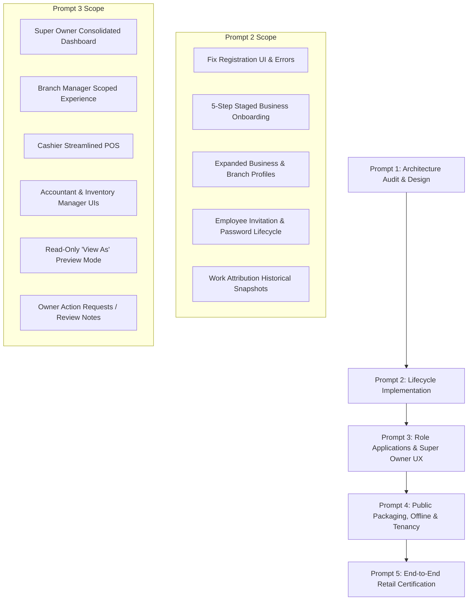

# HBOS Retail Organization Architecture Audit & Target Design
**SkyraSoft HBOS Retail Platform & Workforce Integrity Program — Prompt 1 of 5**

---

## 1. Executive Summary & Audit Baseline
The SkyraSoft HBOS platform has successfully completed its core functional remediation (Phases 1–10) and established foundational public-distribution capabilities (Prompt 1 & 2: shared-database multi-tenancy, Sanctum auth, Spatie team-based permission scopes, branch pivots, and client versioning).

This audit establishes the **Retail Platform & Workforce Integrity Architecture**, defining the operational lifecycle for:
- Self-service business onboarding & profile completion
- Multi-branch establishment and physical store management
- Individual employee identity, recruitment, branch assignments, and role governance
- Separation of Platform Super Admin from Business Super Owner
- Role-specific user experiences for Owner, Branch Manager, Cashier, Accountant, and Inventory Manager
- Super Owner Read-Only "View As" preview mode and Owner Action Requests
- Immutable work attribution and offline transaction actor preservation

---

## 2. Core Separation of Identities

| Identity Category | Security Domain | Scope & Tenancy | Auth Credential Model | Description |
| :--- | :--- | :--- | :--- | :--- |
| **Platform Super Admin** | SkyraSoft Platform | Platform-Wide (No direct tenant browsing) | SkyraSoft Platform Account | System health, version management, abuse handling. Must NOT silently view customer business data without audited, time-limited business consent. |
| **Business Super Owner** | Customer Tenant | Single Business (All Branches) | Individual Owner Account | Root tenant administrator. Full visibility across all branches, consolidated analytics, branch management, employee governance, and View-As preview. |
| **Branch Manager** | Customer Tenant | Single Business (Assigned Branch Only) | Individual Staff Account | Operational leader for a designated store. Manages local POS, sales, inventory, local expenses, and assigned shift staff. |
| **Accountant** | Customer Tenant | Single Business (Financial Ledgers) | Individual Staff Account | Manages customer Khata receivables, supplier payables, expenses, bank accounts, cash movements, and financial statements. |
| **Inventory Manager** | Customer Tenant | Single Business (Catalog & Stock) | Individual Staff Account | Manages products, categories, branch stock balances, adjustments, inter-branch transfers, GRN receiving, and barcodes. |
| **Salesperson / Cashier**| Customer Tenant | Single Business (Assigned Branch POS) | Individual Staff Account | Front-counter POS checkout, scanning, customer lookup, and shift cash handling. |
| **Customer (External)** | Customer Tenant | Business-Scoped Customer Record | CRM Record (Not Staff Login) | Buyer record holding credit ledger (Khata) and contact details. Strictly separated from system staff authentication. |

---

## 3. Principle: Individual Authenticated Identity (No Shared Branch Logins)
A core retail integrity invariant enforced across HBOS:
> **Branches do NOT log in. Human beings log in.**

1. Every employee has a unique email/login credential and password.
2. Every staff account is attached to a primary branch and optional authorized secondary branches via the `branch_user` pivot table.
3. Every mutation (sale, return, stock adjustment, expense, refund) strictly attributes the authenticated `user_id`, `branch_id`, and `role_at_time`.
4. Shared terminal logins ("Branch 1 Account") are strictly forbidden to guarantee complete auditability and non-repudiation.

---

## 4. Current Registration & Onboarding Audit Findings

### Backend Status
- `AuthController::register` provisions:
  1. `Business` record
  2. `Branch` record ('Main Branch', 'MAIN', `is_primary = true`)
  3. `User` record ('Business Owner')
  4. Pivot records (`business_user`, `branch_user`)
  5. Spatie Team Role (`Business Owner`)
  6. Initial Cash Account (`FinancialAccount`: 'Main Cash', 'CASH-MAIN')
  7. Default Core Settings (`receipt_header`, `receipt_footer`, `invoice_prefix`, `currency_symbol`)
- **Backend Pass Status**: Verified working atomically via database transaction with test coverage.

### Frontend Registration UX Gaps (RETAIL-GAP-001 & RETAIL-GAP-002)
1. **CSS Visibility Bug**: `.error-message` in `RegisterView.vue` has `display: none;` in CSS, preventing validation feedback from rendering.
2. **Button Styling Mismatch**: Template uses `.create-btn` while CSS only styles `.signin-button`.
3. **Payload Ignored**: `phone` entered on frontend registration form is discarded by backend `AuthController::register`.
4. **Missing Staged Onboarding**: Registration immediately executes `router.push('/')`, bypassing business type, address, city, tax details, and receipt configurations.

---

## 5. Architectural Implementation Roadmap

