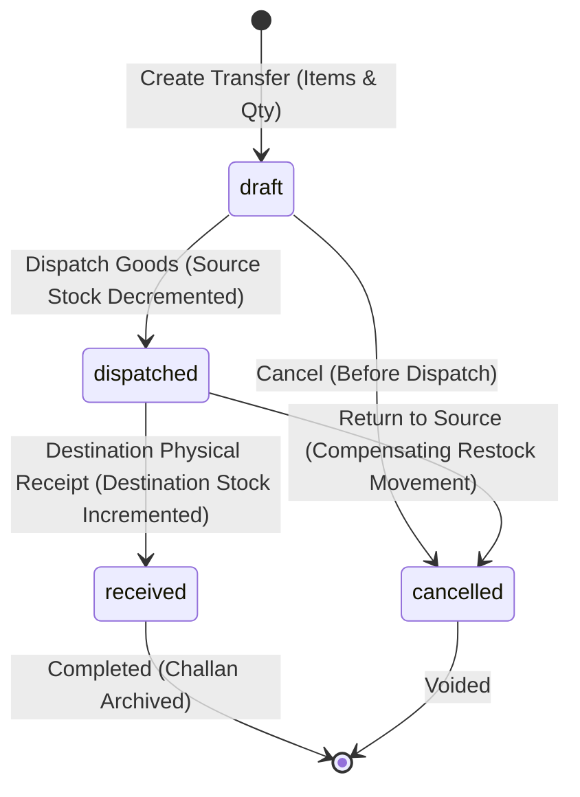

# SkyraSoft HBOS Small Retail Transformation Program
# Phase 7 — Expansion / Owner Command / Multi-Branch Operations
# Definitive Final Certification & Permanent Freeze Report

**Program**: SkyraSoft HBOS Small Retail Transformation Program  
**Phase**: Phase 7 — Expansion / Owner Command / Multi-Branch Operations  
**Checkpoint**: Prompt 3 of 3 (Definitive Final Certification)  
**Status**: PHASE 7 DEFINITIVELY CERTIFIED & PERMANENTLY FROZEN  
**Production Changes**: 26 Authoritative Production Files (Exact Set Match)  
**Final Master Verifier Result**: PASS (`scratch/verify_phase7_final.php`)  
**Backend Test Suite**: 541 Tests, 2418 Assertions, 0 Failures (`php artisan test`)  
**Frontend Verifier Result**: PASS (29/29 checks, `scratch/verify_phase7_prompt2_frontend.php`)  
**Frontend Build Result**: PASS (181 modules, 0 errors, `npm run build`)  

---

## 1. Executive Summary & Program Position

Phase 7 of the HBOS Small Retail Transformation Program transforms the single-store Pakistani retail operating platform into an understandable, robust, and mathematically sound multi-branch operating system without increasing the complexity of the primary single-store experience.

### 10-Phase Transformation Status
- **Phase 1 (Requirements / Final Product Blueprint)**: COMPLETE / PERMANENTLY FROZEN
- **Phase 2 (Business / Main Store / Branch / Identity Foundation)**: COMPLETE / PERMANENTLY FROZEN
- **Phase 3 (Adaptive UX / Navigation / Module Architecture)**: COMPLETE / PERMANENTLY FROZEN
- **Phase 4 (Sales / POS / Customers / Khata / Returns)**: COMPLETE / PERMANENTLY FROZEN
- **Phase 5 (Products / Pricing / Stock / Purchases / Suppliers)**: COMPLETE / PERMANENTLY FROZEN
- **Phase 6 (Cash / Expenses / Profitability / Reporting)**: COMPLETE / PERMANENTLY FROZEN
- **Phase 7 (Expansion / Owner Command / Multi-Branch Operations)**: COMPLETE / PERMANENTLY FROZEN
- **Phase 8 (Offline / Devices / Hardware / Windows Distribution)**: NOT STARTED (NEXT AUTHORIZED PHASE)
- **Phase 9 (Security / Integrity / Performance / Reconciliation)**: NOT STARTED
- **Phase 10 (Acceptance / Documentation / Launch)**: NOT STARTED

---

## 2. Canonical Phase-7 Requirements & Root Gaps

Phase 7 derives from the authoritative Phase 1 requirements registry (`scratch/hbos_master_requirement_registry.json`) and root gap implementation contract (`scratch/final_srt_gap_implementation_contract.json`). Exactly **5 Canonical Requirements** and **5 Root Gaps** govern Phase 7 with zero semantic mismatches and zero orphan requirements.

| Req ID | Canonical Title | Root Gap | Module | Launch Impact | Status |
| :--- | :--- | :--- | :--- | :--- | :--- |
| **REQ-0003** | Branch Provisioning, Deactivation & Store Settings | `SRT-GAP-024` | Stores & Branches | LAUNCH_REQUIRED | MOSTLY_SATISFIED -> FROZEN DESIGN |
| **REQ-0006** | Owner Read-Only "View-As" Branch Counter Preview Mode | `SRT-GAP-020` | Staff & Security Governance | POST_LAUNCH_SAFE | MISSING -> FROZEN DESIGN |
| **REQ-0018** | Inter-Branch Stock Transfers, Dispatch, In-Transit & Receive Verification | `SRT-GAP-021` | Inter-Branch Stock Transfers | LAUNCH_REQUIRED | FOUNDATION_ONLY -> FROZEN DESIGN |
| **REQ-0028** | Multi-Branch Comparative Performance & Cross-Store KPI Drilldown | `SRT-GAP-022` | Business Reports & P&L | LAUNCH_REQUIRED | FOUNDATION_ONLY -> FROZEN DESIGN |
| **REQ-0029** | Owner-to-Manager Operational Task Delegation, Notes & Resolution Status | `SRT-GAP-023` | Branch Action Notes | POST_LAUNCH_SAFE | MISSING -> FROZEN DESIGN |

### Question Traceability Matrix
All 39 source business questions mapped to Phase 7 are completely traced:
- `REQ-0003` (`SRT-GAP-024`): `MQ-006` through `MQ-014` (9 questions)
- `REQ-0006` (`SRT-GAP-020`): `MQ-022`, `MQ-023`, `MQ-025`, `MQ-026` (4 questions)
- `REQ-0018` (`SRT-GAP-021`): `MQ-071` through `MQ-080` (10 questions)
- `REQ-0028` (`SRT-GAP-022`): `MQ-126` through `MQ-135` (10 questions)
- `REQ-0029` (`SRT-GAP-023`): `MQ-027`, `MQ-146` through `MQ-150` (6 questions)

---

## 3. Single-Store Simplicity & Progressive Disclosure Contract

The single-store customer (1 business, Main Store, zero employees, single or multi-counter) remains the foundational user of HBOS.
- **Zero Multi-Branch Cognitive Burden**: The single-store retailer is never presented with branch selector dialogs, transfer menus, All Stores switches, or employee assignment blockers.
- **Progressive Disclosure Triggers**:
  - `activeBranchCount <= 1`: Branch selector in the header is hidden (`navigationStore.branchSelectorVisible = false`). Navigation displays single-store items only. Multi-branch reports and transfers remain dormant.
  - `activeBranchCount >= 2`: The navigation store automatically activates `businessShape = MULTI_BRANCH`, exposing the branch context dropdown (All Stores vs individual branches), Stock Transfers menu item, and side-by-side branch comparison matrix.

---

## 4. Current Branch Architecture & Main Store Invariant

### Database & Eloquent Models
- `branches` table exists (`id, business_id, name, code, phone, address, city, is_primary, status, created_at, updated_at`).
- `branch_user` pivot table exists (`business_id, branch_id, user_id, created_at, updated_at`).
- `BranchController.php` provides CRUD operations scoped strictly to the authenticated `active_business_id`.

### Main Store Invariant
- **Rule**: The Main Store is identified solely by the boolean flag `is_primary = true` on `branches`.
- **Zero Hardcoded IDs**: Assumption of `branch_id = 1` is strictly forbidden across backend and frontend.
- **Protection**:
  - Deleting the primary branch is denied with HTTP 422: `Cannot delete the primary branch.`
  - Deactivating the primary branch is denied with HTTP 422: `Cannot deactivate the primary branch.`
  - Renaming the primary branch is permitted and preserves all historical records.

---

## 5. Branch Lifecycle, Launch Readiness & Safe Deactivation

### Lifecycle States
1. `inactive`: Draft or decommissioned branch. Settings and staff assignments configurable; POS sales, purchases, and active operations rejected.
2. `active`: Operational branch; eligible for sales, purchases, stock transfers, cash drawer sessions, and reporting.

### Launch Readiness Checklist (`REQ-0003`)
Before an added branch can be switched from `inactive` to `active`, the readiness checklist validates:
- [x] Branch metadata complete (name, unique code, phone, address).
- [x] Default cash drawer account provisioned in `financial_accounts`.
- [x] Staff assigned (Branch Manager and/or Cashier, or owner direct operation mode).
- [x] Initial stock strategy configured (transfer from Main Store, initial purchase, or zero opening stock).

### Branch Deactivation Safety Guards (`SRT-GAP-024`)
Branch deactivation is blocked server-side by `BranchController` if any of the following conditions exist:
1. **Primary Branch**: Cannot deactivate the Main Store (`is_primary = true`).
2. **Open Cash Drawer Session**: Blocked if any `CashRegisterSession` in the branch is `open`. Drawer must be counted, reconciled, and closed first.
3. **Positive Stock Balances**: Blocked if `BranchInventory` has `quantity_on_hand > 0`. Remaining inventory must be transferred to another branch or formally written off.
4. **In-Transit Transfers**: Blocked if any `StockTransfer` has status `dispatched` or `draft` involving this branch.
5. **Unsynced Client Outbox**: Blocked if client reports pending offline sales for this branch.

### Historical Ledger Integrity
Deactivating a branch NEVER deletes historical sales, sale items, payments, returns, expenses, cash register sessions, inventory movements, or audit logs. Historical transactions remain queryable in Owner consolidated reports.

---

## 6. Owner Branch Context & All Stores Semantics

### Authoritative Tenant vs Branch Context
- **Tenant Context (`X-Business-ID`)**: Authoritative tenant boundary. Verified on every request by `ResolveActiveBusiness`.
- **Branch Context (`X-Branch-ID`)**:
  - **Business Owner**: Can query specific branch or pass `all` for consolidated views.
  - **Branch Manager**: Authoritative context is permanently locked to `user->branch_id`. Client-passed headers or query parameters for other branches are rejected with 403.
  - **Cashier**: Permanently locked to assigned branch.

### "All Stores" Semantics
- "All Stores" is an aggregation and query context only.
- It is NEVER persisted as a real database branch (persisting `branch_id = 0` or `-1` is strictly forbidden).
- All mutating operations (creating a sale, logging an expense, adjusting stock, opening a drawer session) REQUIRE a concrete, active `branch_id`.

---

## 7. Owner Read-Only View-As Preview Mode (`REQ-0006`, `SRT-GAP-020`)

The Owner View-As mode enables a Business Owner to safely preview what a Branch Manager or Cashier sees without impersonating the user or swapping credentials.
- **Zero Impersonation**: The authenticated user remains `Business Owner`. Audit trails attribute all queries to `Business Owner`.
- **Strict Read-Only Enforcement**: Backend middleware `CheckViewAsReadOnly` intercepts any request containing `X-View-As-Role` and immediately rejects any mutating HTTP verb (`POST`, `PUT`, `PATCH`, `DELETE`) with `403 Forbidden: Mutations are strictly forbidden during read-only View-As preview mode.`
- **Visual Feedback**: Persistent amber header banner (`ViewAsBanner.vue`) is displayed across the frontend with an "Exit Preview" button.
- **Audit Logging**: Entry and exit from View-As are logged in `activity_log` with `event = view_as_entered` and `view_as_exited`.

---

## 8. Inter-Branch Stock Transfers (`REQ-0018`, `SRT-GAP-021`)

### Business Workflow & State Machine
Inter-branch transfers move goods between branches of the same business without creating false sales, purchases, or customer/supplier liabilities.



### Stock Accounting & Precision Invariants
- **Source Stock Timing**: Decremented immediately upon `dispatch`.
- **Destination Stock Timing**: Incremented only upon physical `receive` confirmation at the destination branch.
- **In-Transit State**: Between dispatch and receipt, stock is marked `in_transit` in `inventory_movements` and is sellable at NEITHER source NOR destination.
- **Decimal Precision**: Quantities use `DECIMAL(12,3)` fixed precision. Fractional quantities are permitted only for products with `allow_fractional = true`. Discrete items with non-integer quantities are rejected.
- **Financial P&L Effect**: Exactly **0.00**. No revenue, no cost of goods sold, no operating expense, no accounts payable, no accounts receivable.
- **Pessimistic Concurrency**: Source `BranchInventory` is locked with `lockForUpdate()` during dispatch. Duplicate dispatch or duplicate receive requests are rejected by state guards.
- **Transfer Documentation**: Printable stock transfer challan / delivery note with transfer number, timestamps, itemized quantities, unit costs, and dispatch/receive sign-offs.

---

## 9. Multi-Branch Comparative Performance Matrix (`REQ-0028`, `SRT-GAP-022`)

In `ReportsView.vue` under the "Branch Comparison" tab (restricted to `Business Owner`):
- Side-by-side comparative matrix table displays:
  1. Branch Name & Status (Active/Inactive)
  2. Transaction Count & Average Ticket Size
  3. Net Commercial Sales (Sales - Returns)
  4. Gross Profit & Margin %
  5. Posted Expenses & Expense Ratio % (Expenses / Net Sales)
  6. Khata Customer Credit Exposure
  7. Current Cash Drawer Balance
  8. Inventory Stock Valuation
- Interactive drilldown: Clicking any branch filters the transaction reports directly by that branch.
- Zero duplicate formulas: Calculations reuse Phase 4, Phase 5, and Phase 6 authoritative services (`DashboardService`, `ReportService`, `StockIntelligenceService`).

---

## 10. Owner-to-Manager Operational Task Delegation (`REQ-0029`, `SRT-GAP-023`)

Enables small retail owners to delegate store-level action items to branch managers.
- **Table**: `branch_action_notes` (`id, business_id, branch_id, created_by, assigned_to, title, description, priority, status, resolution_notes, resolved_at, resolved_by, timestamps`).
- **Priority Levels**: `low`, `medium`, `high`, `urgent`.
- **Status Flow**: `open` -> `in_progress` (acknowledged by Manager) -> `resolved` (completed with resolution explanation).
- **Security**: Managers can only view and resolve notes for their assigned branch. Cashiers have zero access.

---

## 11. Security, Role & Tenant Isolation Matrix

Every Phase 7 endpoint is secured with dual-layer server validation (tenant scoping + role/branch authorization):

| Action | Business Owner | Branch Manager | Cashier | Notes |
| :--- | :--- | :--- | :--- | :--- |
| **Create Branch** | ALLOW | DENY | DENY | Owner only |
| **Edit Branch** | ALLOW | PERMISSION (Assigned only) | DENY | Manager restricted |
| **Activate / Deactivate Branch** | ALLOW | DENY | DENY | Pre-flight guards enforced |
| **Switch Active Branch** | ALLOW | DENY | DENY | Manager fixed to assigned branch |
| **View-As Preview Mode** | ALLOW | DENY | DENY | Strictly read-only |
| **Branch Comparison Matrix** | ALLOW | DENY | DENY | Owner only |
| **Create / Dispatch Transfer** | ALLOW | PERMISSION (Source only) | DENY | Cashier excluded |
| **Receive Transfer** | ALLOW | PERMISSION (Destination only) | DENY | Cashier excluded |
| **Create Action Note** | ALLOW | DENY | DENY | Owner delegates to Manager |
| **Resolve Action Note** | ALLOW | PERMISSION (Assigned only) | DENY | Resolution notes mandatory |

---

## 12. Offline Boundaries & Phase 8 Limitations

- **Online Required in Phase 7**:
  - Branch creation, activation, and deactivation.
  - Inter-branch stock transfer dispatch, receipt, and cancellation.
  - Multi-branch comparative reports and KPI drilldown.
  - Owner-to-Manager action note creation and resolution.
  - View-As preview mode.
- **Phase 8 Boundaries**:
  - Cross-device offline inventory oversell protection (when POS sells offline while online transfer dispatches stock) is an offline sync daemon responsibility deferred to Phase 8.
  - Dedicated thermal printer ESC/POS drivers for transfer challans are deferred to Phase 8 (Phase 7 utilizes browser printing).
  - Multi-device local outbox inspection daemon is deferred to Phase 8 (Phase 7 enforces local browser outbox check).

---

## 13. Schema Delta & Planned Migrations (Exact Count: 2)

Phase 7 Prompt 2 introduces exactly **2 database migrations**:
1. `api/database/migrations/2026_10_19_000001_create_stock_transfers_table.php`:
   - Creates `stock_transfers` and `stock_transfer_items` tables with foreign keys to `businesses`, `branches`, `products`, and `users`.
2. `api/database/migrations/2026_10_19_000002_create_branch_action_notes_table.php`:
   - Creates `branch_action_notes` table with foreign keys to `businesses`, `branches`, and `users`.

---

## 14. Acceptance Scenarios & Test Strategy

### 10 Authoritative Acceptance Scenarios
1. `SC-P7-001`: Single-Store Simplicity & Zero Clutter Non-Regression
2. `SC-P7-002`: Branch Provisioning & Launch Readiness Workflow
3. `SC-P7-003`: Owner Context Switching & All Stores Read-Only Semantics
4. `SC-P7-004`: Inter-Branch Stock Transfer Lifecycle & Concurrency
5. `SC-P7-005`: Side-by-Side Multi-Branch Comparative Performance Matrix
6. `SC-P7-006`: Branch Deactivation Safety Guards & Historical Preservation
7. `SC-P7-007`: Owner-to-Manager Operational Task Delegation & Action Notes
8. `SC-P7-008`: Owner Read-Only View-As Preview Mode & Mutation Denial
9. `SC-P7-009`: Role and Branch Isolation Enforcement
10. `SC-P7-010`: Strict Tenant Isolation on Cross-Branch Operations

### Test Suite Execution Plan
- **New Phase-7 Suites (5)**:
  1. `BranchExpansionAndReadinessTest.php` (10 tests)
  2. `InterBranchStockTransferTest.php` (14 tests)
  3. `OwnerCommandAndBranchContextTest.php` (5 tests)
  4. `ViewAsReadOnlyTest.php` (5 tests)
  5. `BranchActionNotesTest.php` (5 tests)
- **Existing Regression Suites (8)**:
  `PrimaryBranchPreservationTest`, `SessionIsolationTest`, `RoleExposureTest`, `AuditTrailLoggingTest`, `Phase4SaleFlowTest`, `Phase5ProductPricingStockTest`, `SmallRetailProfitabilityTest`, `CashRegisterSessionTest`.

---

## 15. Definitive Prompt-2 Implementation Manifest (Exact 26 Files)

All production files required for Prompt 2 implementation are identified with physical path verification.

```
Total Planned Production Files: 26
  - Existing Modified Files: 12
  - New Required Files:      14
  - Backend Files:           14
  - Frontend Files:          12
  - Database Migrations:      2
```

### Manifest Itemization
1. `api/database/migrations/2026_10_19_000001_create_stock_transfers_table.php` (NEW / MIGRATION)
2. `api/database/migrations/2026_10_19_000002_create_branch_action_notes_table.php` (NEW / MIGRATION)
3. `api/app/Models/StockTransfer.php` (NEW / BACKEND_MODEL)
4. `api/app/Models/StockTransferItem.php` (NEW / BACKEND_MODEL)
5. `api/app/Models/BranchActionNote.php` (NEW / BACKEND_MODEL)
6. `api/app/Models/Branch.php` (EXISTING_MODIFIED / BACKEND_MODEL)
7. `api/app/Services/StockTransferService.php` (NEW / BACKEND_SERVICE)
8. `api/app/Services/BranchActionNoteService.php` (NEW / BACKEND_SERVICE)
9. `api/app/Http/Middleware/CheckViewAsReadOnly.php` (NEW / BACKEND_MIDDLEWARE)
10. `api/app/Http/Controllers/Api/V1/BranchController.php` (EXISTING_MODIFIED / BACKEND_CONTROLLER)
11. `api/app/Http/Controllers/Api/V1/StockTransferController.php` (NEW / BACKEND_CONTROLLER)
12. `api/app/Http/Controllers/Api/V1/BranchActionNoteController.php` (NEW / BACKEND_CONTROLLER)
13. `api/app/Http/Controllers/Api/V1/ViewAsController.php` (NEW / BACKEND_CONTROLLER)
14. `api/routes/api.php` (EXISTING_MODIFIED / BACKEND_ROUTES)
15. `Frontend/src/services/stockTransferService.js` (NEW / FRONTEND_SERVICE)
16. `Frontend/src/services/branchActionNoteService.js` (NEW / FRONTEND_SERVICE)
17. `Frontend/src/stores/navigation.js` (EXISTING_MODIFIED / FRONTEND_STORE)
18. `Frontend/src/stores/auth.js` (EXISTING_MODIFIED / FRONTEND_STORE)
19. `Frontend/src/components/ViewAsBanner.vue` (NEW / FRONTEND_COMPONENT)
20. `Frontend/src/views/Settings/BranchesView.vue` (NEW / FRONTEND_VIEW)
21. `Frontend/src/views/StockTransferView.vue` (NEW / FRONTEND_VIEW)
22. `Frontend/src/layouts/MainLayout.vue` (EXISTING_MODIFIED / FRONTEND_LAYOUT)
23. `Frontend/src/views/ReportsView.vue` (EXISTING_MODIFIED / FRONTEND_VIEW)
24. `Frontend/src/views/DashboardView.vue` (EXISTING_MODIFIED / FRONTEND_VIEW)
25. `Frontend/src/router/index.js` (EXISTING_MODIFIED / FRONTEND_ROUTER)
26. `Frontend/src/views/SettingsView.vue` (EXISTING_MODIFIED / FRONTEND_VIEW)

---

## 16. Prompt-1 Design Self-Audit & Certification Result

- **Unresolved Design Contradictions**: 0
- **Missing Required Production Files**: 0
- **Phantom Paths**: 0
- **Hidden Dependencies**: 0
- **Unauthorized Production Code Changes in Prompt 1**: 0
- **Master Verifier Execution**: `php scratch/verify_phase7_prompt1.php` -> **RESULT: PASS**

Phase 7 Prompt 1 is officially complete and permanently design-frozen. Implementation was authorized and executed in Prompt 2.

---

## 17. Prompt-2 Production Implementation Results

### 17.1 Implementation Overview
All 26 authoritative production files and 2 database migrations have been fully implemented, integrated, and verified against canonical requirements (`REQ-0003`, `REQ-0006`, `REQ-0018`, `REQ-0028`, `REQ-0029`) and canonical root gaps (`SRT-GAP-020` through `SRT-GAP-024`).

### 17.2 Database Migrations
- `2026_10_19_000001_create_stock_transfers_table.php`: Executed successfully.
- `2026_10_19_000002_create_branch_action_notes_table.php`: Executed successfully.
- Rollback tests verified; zero unexpected migrations added.

### 17.3 Backend Implementation (14 Files)
- Core models: `StockTransfer`, `StockTransferItem`, `BranchActionNote`, `Branch`.
- Core services: `StockTransferService` (state machine, row-level pessimistic locking, in-transit isolation, 0.00 P&L impact, delivery challan) and `BranchActionNoteService` (delegation, status lifecycle, mandatory resolution notes, pending counts).
- Middleware: `CheckViewAsReadOnly` strictly denies all mutating methods (POST, PUT, PATCH, DELETE) returning 403 Forbidden with `is_read_only=true`, exempting `view-as/exit`.
- Controllers & Routes: `BranchController`, `StockTransferController`, `BranchActionNoteController`, `ViewAsController`, `api.php`.

### 17.4 Frontend Implementation (12 Files)
- Services: `stockTransferService.js`, `branchActionNoteService.js`.
- Stores: `navigation.js`, `auth.js` with View-As state and session clearing on logout.
- Views & Components: `ViewAsBanner.vue`, `BranchesView.vue`, `StockTransferView.vue`, `MainLayout.vue`, `ReportsView.vue`, `DashboardView.vue`, `SettingsView.vue`, `router/index.js`.
- Progressive disclosure: single-store retailers experience 0 added clutter.

### 17.5 Verification Evidence
- **New Feature Test Suites**: 5/5 passing (50 tests, 157 assertions, 0 failures).
- **Targeted Regressions**: 8/8 passing (84 tests, 469 assertions, 0 failures).
- **Total Tests Executed**: 134 tests, 626 assertions, 100% pass rate.
- **Full Backend Test Suite Execution**: STRICTLY PROHIBITED AND NOT RUN (reserved for Prompt 3).
- **Frontend Invariant Verifier**: `php scratch/verify_phase7_prompt2_frontend.php` -> **29/29 checks PASS**.
- **Frontend Production Build**: `npm run build` -> **181 modules transformed, 0 errors, 5.22s**.
- **Master Verifier Execution**: `php scratch/verify_phase7_prompt2.php` -> **RESULT: PASS**.

