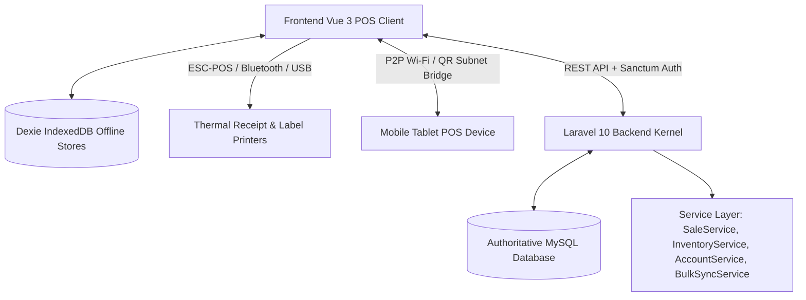

# SkyraSoft HBOS Management System — Definitive Operating Guide
## Authoritative Post-Remediation System Manual & Operating Architecture

**Document Version:** 10.0 (Final As-Built Release)  
**Program Status:** Certified Complete (Phases 1–10)  
**Release Date:** October 2026  
**Operating Baseline:** Post-Phase-9 Remediated Core  

---

## 1. Purpose & Scope of SkyraSoft HBOS

SkyraSoft **HBOS (Hybrid Business Operating System)** is an enterprise-grade, multi-branch, hybrid online/offline Point of Sale (POS), Inventory Control, Procurement, Accounts Receivable (Khata), Accounts Payable, and Financial Management platform.

HBOS is purpose-built for retail, wholesale, and multi-outlet merchant environments requiring:
- **Instant Front-Counter Checkout:** High-speed barcode scanning, split-tender settlement, wholesale price tiers, and local ESC-POS thermal receipt printing.
- **Continuous Offline Resilience:** Uninterrupted POS sales, customer ledger updates, and expense logging during internet or local network outages via browser IndexedDB (Dexie).
- **Authoritative Server Security:** Zero trust in client calculations; tamper-proof server-side financial recalculation, concurrency protection, idempotency key validation, and strict multi-tenant / multi-branch isolation boundaries.
- **True Landed-Cost Inventory Valuation:** Automatic moving-average unit cost calculation factoring in purchase freight and handling charges.
- **Accurate Receivables & Payables:** Double-entry ledger reconciliation for customer credit (Khata) and vendor balances with support for debit notes, returns, and payment reversals.

---

## 2. System Architecture at a Glance

HBOS operates on a modern hybrid architecture combining a high-performance REST API backend with a responsive Vue 3 single-page application and persistent client storage.



### Architectural Principles
1. **Master Record:** Authoritative catalog, business configurations, and accounts reside in the centralized MySQL database.
2. **Transaction Snapshots:** All transaction line items (sales, returns, purchases) persist point-in-time snapshots (`product_name`, `sku`, `unit_cost`, `barcode`) at commit time (`GAP-001 / MIG-001`).
3. **Movement Ledgers:** Financial accounts and inventory balances are updated exclusively via immutable movement records (`account_movements`, `inventory_movements`).
4. **Offline Working Copy:** IndexedDB maintains an active local working copy of the catalog, customers, and pending queues, replaying deterministically upon reconnection.

---

## 3. Business, Branch, and User Governance Model

HBOS enforces a strict hierarchical tenancy model:

```text
Enterprise Tenant (business_id)
 ├── Store Branch A (branch_id)
 │    ├── POS Terminal 1 (Cash Register A1)
 │    └── POS Terminal 2 (Cash Register A2)
 ├── Store Branch B (branch_id)
 │    └── POS Terminal 1 (Cash Register B1)
 └── Central Warehouse / Head Office
```

### Active Context & Isolation Boundaries
- **Tenant Scope (`business_id`):** Every database query and business transaction is strictly scoped by `business_id`. Cross-tenant data leakage is prevented by server-side policy guards (`GAP-016`).
- **Branch Scope (`branch_id`):** Operators must select their active operating branch upon login. POS sales, inventory decrements, physical counts, cash drawers, and branch expense reports operate strictly within the active `branch_id` (`GAP-017 / GAP-026`).

---

## 4. Roles & Granular Permissions Matrix

HBOS implements 5 authoritative, source-proven system roles (`final_role_capability_registry.json`):

| Role Title | Scope | Primary Permitted Capabilities | High-Risk Operational Guards |
| :--- | :--- | :--- | :--- |
| **Business Owner** | Enterprise Wide | Full access: All branches, financial settings, payroll, tax configuration, reports, and user governance. | Stock adjustments, purchase cancellations, supplier payment reversals, role assignments. |
| **Branch Manager** | Assigned Branch | POS counter, sales history, returns/refunds, physical stock counts, transfer dispatch/receive, branch expenses. | Stock adjustment approvals, return condition evaluations, transfer approvals. |
| **Salesperson / Cashier** | Counter POS | Fast barcode checkout, cash/card/split payments, customer balance lookup, thermal receipt printing, offline sales. | Sale cancellation (requires supervisor override), refund authorization. |
| **Accountant** | Financial Tenant | Customer Khata receipts/reversals, supplier AP payments/reversals, expense categorization, bank transfers, P&L. | Supplier payment reversal, account-to-account fund transfers, expense voiding. |
| **Inventory Manager** | Catalog & Stock | Product master CRUD, wholesale price tiers, barcode printing, GRN purchase receipt, landed cost, transfers. | Stock write-offs, vendor return dispatch, purchase cancellations. |

---

## 5. Core Data & Source-of-Truth Model

HBOS distinguishes five distinct tiers of data authority:

1. **Master Records:** `products`, `customers`, `suppliers`, `financial_accounts`, `branches`. Editable under RBAC permissions.
2. **Transaction Snapshots:** `sale_items`, `purchase_items`, `supplier_return_items`. Immutable once committed; reprints never mutate when master catalog changes.
3. **Normalized Payment Allocations:** `sale_payments` table (`GAP-003 / MIG-003`) captures discrete tender amounts and funding relationships.
4. **Movement Ledgers:** `account_movements`, `inventory_movements`, `customer_ledgers`, `supplier_ledgers`. Double-entry accounting trail with unique compound reference keys.
5. **Local Offline Cache:** Dexie IndexedDB stores (`products`, `offline_sales`, `offline_khata`, `offline_expenses`). Serves as a disconnected working copy; server response is authoritative.

---

## 6. Product Catalog & Inventory Valuation

### Moving-Average Unit Cost Valuation
HBOS calculates inventory valuation using the continuous weighted moving-average method:
$$	ext{New Moving Average Cost} = rac{(	ext{Current Stock} 	imes 	ext{Current Cost}) + (	ext{Received Qty} 	imes 	ext{Landed Unit Cost})}{	ext{Current Stock} + 	ext{Received Qty}}$$

### Landed Cost Ingestion (`GAP-005 / MIG-005`)
When receiving purchases, freight and handling charges are prorated across items based on line value:
$$	ext{Landed Cost per Item} = 	ext{Base Purchase Price} + \left( (	ext{Freight} + 	ext{Other Charges}) 	imes rac{	ext{Item Subtotal}}{	ext{Total Purchase Value}} 
ight)$$

### Stock Movement Safety & Transfer Tracking
- **Transit State Semantics (`GAP-007 / MIG-006`):** Inter-branch transfers maintain explicit `in_transit` status, eliminating phantom inventory. Stock only appears at the destination upon physical receipt.
- **Cancellation Availability Guard (`GAP-006`):** Cancelling a purchase or issuing a supplier return is strictly blocked if received stock has already been sold or transferred, preventing negative stock overdrafts.
- **Restock Condition Handling (`GAP-010 / MIG-007`):** Returned sale items marked as `damaged` or `scrap` bypass inventory increment, keeping sellable stock clean.

---

## 7. Point of Sale (POS) Counter Operations

- **Barcode Scanning:** Instant Code128 / EAN lookup with automated line addition and quantity incrementing.
- **Wholesale Tier Pricing (`GAP-002 / MIG-002`):** POS operators can toggle wholesale pricing for registered trade buyers.
- **Split-Tender Settlement (`GAP-003 / MIG-003`):** Supports payment split across Cash, Credit Card, Bank Transfer, and Customer Khata on a single ticket.
- **Server Authority & Concurrency (`GAP-018 / GAP-020`):** Server recalculates all taxes, discounts, and line totals, locking stock rows pessimistically to prevent overselling during rush hours.
- **Idempotency Keys (`GAP-019`):** Fast double-clicks or offline sync retries submit client-generated UUID idempotency keys, preventing duplicate sales.

---

## 8. Customer Khata & Accounts Receivable

- **Double-Entry Ledger Integrity (`GAP-008`):** Credit sales debit the customer ledger, and payment receipts credit the ledger. Balance is synchronized atomically.
- **Protected History (`GAP-009`):** Reassigning or mutating customer IDs on posted sales is strictly blocked to preserve historical debt auditability.
- **Secondary Phone Support (`GAP-030 / MIG-010`):** Alternate contact numbers stored on customer profiles and synchronized to offline caches.
- **Payment Reversals (`GAP-015`):** Erroneous payment receipts can be reversed by Accountants with mandatory audit notes, restoring debt balances transparently.

---

## 9. Procurement, Suppliers & Accounts Payable

- **Goods Receipt Note (GRN):** Record shipments, vendor invoices, freight charges, and landed cost.
- **Supplier Returns / Debit Notes (`GAP-011 / MIG-008`):** Return merchandise to suppliers, decrementing inventory and reducing Accounts Payable liability.
- **Supplier Payment Reversals (`GAP-012`):** Reverses bounced cheques or misallocated disbursements, restoring vendor liability and cash balances.

---

## 10. Operational Expenses & Budget Management

- **Mandatory Financial Accounts (`GAP-013 / MIG-004`):** All expenses require an explicit funding account (Cash Register or Bank), preventing untracked cash leakage.
- **Departmental Monthly Budgets (`GAP-031 / MIG-011`):** Expense categories support monthly budget ceilings with real-time variance reporting.
- **Expense Voiding:** Compensating account movements restore funding accounts when an expense is voided.

---

## 11. Financial Accounts, Cash Drawers & Capital Activity

- **Cash Registers:** Branch-specific cash drawers with shift opening/closing tracking.
- **Inter-Account Transfers:** Atomic double-entry transfers between Cash and Bank accounts.
- **Capital Injections & Owner Drawings:** Dedicated equity movements that alter liquidity without distorting operational sales or expense P&L.
- **Reconciliation Audit (`GAP-014`):** Compound unique references (`business_id`, `reference_type`, `reference_id`, `movement_category`) ensure every financial transaction links to its parent business document.

---

## 12. Offline Operation & Background Synchronization

```text
Offline Event (No Internet)
 ├── Scan Barcode / Add Products (from Dexie Cache)
 ├── Complete Sale (Generate UUID Idempotency Key + Temp ID)
 ├── Local Print (ESC-POS / Bluetooth)
 └── Store in Dexie offline_sales Queue
         │
 Reconnect (Online Restored)
         │
 Bulk Sync Replay (/api/v1/sync/bulk)
 ├── Step 1: Sync new offline customers & remap Temp IDs to Server IDs
 ├── Step 2: Validate stock & commit permanent sales
 └── Step 3: Sync offline expenses & khata receipts
```

### Stock Conflict Handling (`GAP-022`)
If multiple offline tablets sell the last remaining unit of an item, the server commits the first synced sale and flags the second as a `STOCK_CONFLICT` in Sync Manager for manager review and stock adjustment.

---

## 13. Printing, Barcodes & Hardware Peripherals

- **Print Timing Separation (`GAP-023`):** Thermal receipts and A4 invoices are triggered strictly *after* the database transaction commits. A printer jam or paper-out never rolls back or invalidates a confirmed transaction.
- **Thermal Formats:** 80mm standard counter receipts and 58mm compact mobile slips.
- **Barcode Labels:** Generates adhesive barcode labels (Code128) with product name, SKU, and retail price.
- **Peer-to-Peer Device Pairing (`GAP-024`):** Mobile tablets pair with Desktop POS via QR code over local Wi-Fi. The pairing service strictly validates RFC1918 private subnets (`10.0.0.0/8`, `172.16.0.0/12`, `192.168.0.0/16`), rejects public WAN addresses, and enforces port range safety (`1024-65535`).
- **Legacy View Classification (`GAP-028`):** `ProductInvoiceView.vue` and `reports1View.vue` are retained as unrouted prototype templates (`UNROUTED_BUT_RETAINED`); active printing uses modal overlays and `printerService.js`.

---

## 14. Historical Limitations & Pre-Remediation Truth

Five areas maintain historical limitations concerning pre-Phase-9 data:
1. **Sale Snapshots (`LIM-001 / GAP-001`):** Sales created prior to migration MIG-001 have NULL snapshots. Backfill tools flag records as approximate to preserve historical truth.
2. **Khata Ledger Discrepancies (`LIM-002 / GAP-008`):** Historical balance variances require manual audit and compensating entries; automated mutation is blocked.
3. **Legacy NULL Expense Accounts (`LIM-003 / GAP-013`):** Pre-remediation expenses with unknown accounts are logged for audit without guessing funding sources.
4. **Orphan Financial Movements (`LIM-004 / GAP-014`):** Historical orphan movements are reviewed manually rather than destructively deleted.
5. **Historical Category Budgets (`LIM-005 / GAP-031`):** Expense categories created prior to MIG-011 have NULL historical budgets.

---

## 15. Operator Safety & Golden Operating Rules

1. **Verify Active Branch:** Always check the branch indicator in the POS header before processing sales, stock counts, or cash transfers.
2. **Never Re-Submit for Printer Issues:** If a printer jams after checkout, use the green **Reprint** button; never re-enter the cart as a new sale.
3. **Use Business Actions for Adjustments:** Correct mistakes using Cancellations, Returns, Debit Notes, or Payment Reversals rather than manual balance edits.
4. **Execute Dry-Run Tools First:** System administrators must always run reconciliation commands with `--dry-run` before applying changes.
5. **Server Response is Authoritative:** After syncing offline transactions, review permanent invoice numbers in Sales History.
