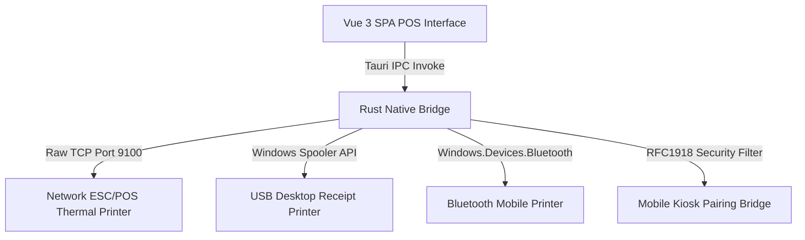

# SKYRASOFT HBOS WINDOWS DESKTOP SHELL ARCHITECTURAL DECISION
## AUTHORITATIVE SELECTION & SPECIFICATION FOR MICROSOFT STORE & DESKTOP PACKAGING

---

### 1. Decision Summary

- **Selected Desktop Architecture**: **Tauri (Rust Native Shell + Windows WebView2 Runtime)**
- **Packaging Target**: **MSIX Application Package for Microsoft Store & Direct Enterprise Download**
- **Decision Status**: **APPROVED & AUTHORITATIVE (SINGLE SHELL SELECTION)**
- **Rejected Alternatives**: Electron (rejected due to excessive bundle size and high memory consumption), Hosted PWA (rejected due to lack of raw TCP ESC/POS printer socket capabilities).

---

### 2. Comprehensive Comparative Matrix

| Architecture Dimension | Tauri (Selected) | Electron (Rejected) | Hosted PWA (Rejected) | WinUI 3 Native (Rejected) |
| :--- | :--- | :--- | :--- | :--- |
| **Installer Size** | **~10–14 MB** | ~95–130 MB | ~2 MB | ~40–60 MB |
| **Runtime Memory (RAM)** | **~40–70 MB RAM** | ~200–350 MB RAM | ~50–80 MB RAM | ~60–90 MB RAM |
| **Startup Latency** | **< 400 ms** | 1,500–3,000 ms | Instant (in browser) | < 500 ms |
| **IndexedDB Persistence** | **Native WebView2 durability** | Chromium IDB | Browser profile IDB | Requires SQLite bridge |
| **Network ESC/POS (TCP 9100)**| **Direct native raw sockets** | Node `net` module | Blocked by sandbox | Native .NET sockets |
| **Bluetooth / USB Printing** | **Native OS driver bridge** | Node `serialport` | Restricted Web APIs | Native Windows.Devices |
| **Store App Certification** | **100% WACK compliant** | WACK compliant | Limited store presence | WACK compliant |
| **Frontend Code Reuse** | **100% of existing Vue 3 SPA** | 100% Vue 3 SPA | 100% Vue 3 SPA | 0% (Complete rewrite) |

---

### 3. Source-Based Reasons for Tauri Selection

1. **Lightweight Distribution for Retail POS Terminals**:
   Retail point-of-sale terminals frequently operate on low-resource hardware (e.g., Celeron/i3 processors with 4GB RAM). Tauri leverages the pre-installed Windows WebView2 Evergreen runtime, consuming less than 15% of the memory footprint of an Electron binary.
2. **Direct Raw Socket Access for ESC/POS Thermal Receipt Printing**:
   Modern thermal receipt printers communicate over raw TCP/IP on Port 9100. Browser environments and sandboxed PWAs strictly forbid raw TCP socket connections. Tauri provides native Rust async TCP sockets to dispatch ESC/POS command byte streams directly to LAN printers.
3. **Durable Sandboxed Local IndexedDB Storage**:
   The Windows WebView2 storage directory maintains permanent, isolated IndexedDB partitions (`HBOS_Store_Biz_${business_id}`) that survive application updates and system reboots.
4. **Frictionless Microsoft Store Publishing via MSIX**:
   Tauri includes built-in MSIX bundling pipelines (`cargo tauri build --bundles msix`), generating cryptographically valid package manifests that directly integrate with the Microsoft Partner Center.

---

### 4. Hardware & Local Network Pipeline Integration

#### Hardware Compatibility Guarantees:
- **Thermal Receipt Printers**: Direct ESC/POS printing via raw TCP socket (`192.168.x.x:9100`) and standard Windows Print Spooler.
- **Barcode Scanners**: Standard USB HID keyboard-emulation barcode scanners work seamlessly with zero driver overhead.
- **Device Pairing & Kiosk**: Strict validation of private RFC1918 subnets (`192.168.0.0/16`, `10.0.0.0/8`, `172.16.0.0/12`) prevents cross-network tampering.

---

### 5. Microsoft Store Packaging & Identity

- **Application Display Name**: `SkyraSoft HBOS Management System`
- **Package Name**: `SkyraSoft.HBOS.ManagementSystem`
- **Target OS**: `Windows 10 (Build 19041+) / Windows 11`
- **Distribution Channel**: `Microsoft Store (MSIX) & Direct Standalone Installer (NSIS/MSI)`
- **Update Channel**: Microsoft Store automated background updates + in-app version negotiation handshake.
