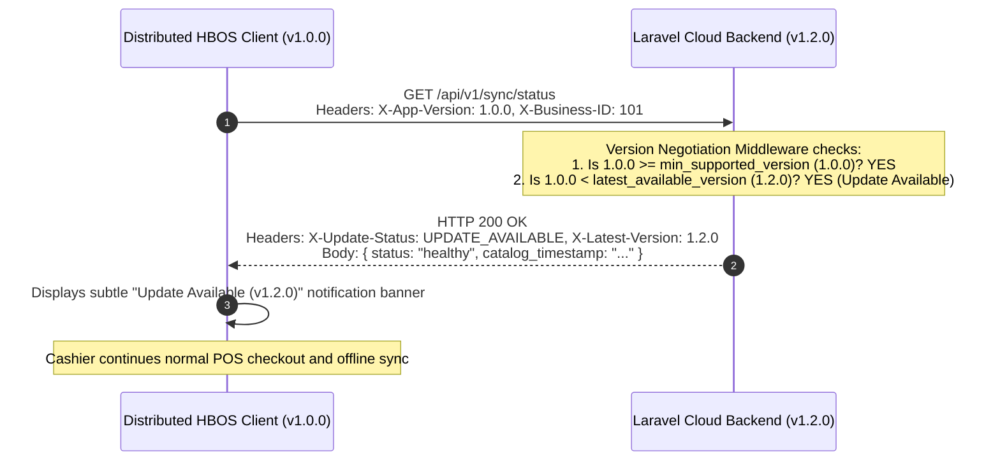

# SKYRASOFT HBOS WINDOWS DISTRIBUTION & CLIENT UPDATE LIFECYCLE DESIGN
## AUTHORITATIVE ARCHITECTURAL SPECIFICATION FOR MICROSOFT STORE & DESKTOP PACKAGING

---

### 1. Windows Desktop Packaging Technology Evaluation

HBOS's frontend is a modern Single Page Application built with Vue 3, Pinia, and Vite. To package and distribute the client for the Windows operating system and the **Microsoft Store**, the following candidate technologies were evaluated:

| Evaluation Criteria | Progressive Web App (PWA / Hosted Web App) | Tauri (Rust + WebView2) | Electron (Chromium + Node.js) | Native C#/WinUI 3 Wrapper |
| :--- | :--- | :--- | :--- | :--- |
| **Package / Installer Size** | Minimal (~2 MB shell) | **Very Small (~10–15 MB)** | Large (~80–120 MB) | Moderate (~30–50 MB) |
| **Memory Footprint** | Low (Shared browser engine) | **Very Low (~40–80 MB RAM)** | High (~150–300 MB RAM) | Low (~60–100 MB RAM) |
| **Offline IndexedDB Support** | Full (Standard browser IDB) | **Full (Native WebView2 IDB)** | Full (Chromium IDB) | Requires SQLite bridge |
| **Hardware & Printer Pipelines** | Limited (No raw TCP/USB sockets) | **Full (Native Rust raw sockets/USB/ESC/POS)** | Full (Node.js `net`, `serialport`) | Full (.NET hardware APIs) |
| **Bluetooth / LAN Access** | Restricted by browser sandbox | **Direct OS socket & network access** | Direct OS socket & network access | Full native OS access |
| **Microsoft Store Packaging** | MSIX via PWABuilder | **Native MSIX / AppX bundle via Cargo** | MSIX via `electron-builder` | Native MSIX packaging |
| **Auto-Update Mechanism** | Web server refresh | **Tauri built-in updater + Store updates** | `electron-updater` + Store updates | Windows Store automatic updates |
| **Code Signing & Store Ingestion** | Store signed automatically | **Store signed automatically via Partner Center** | Store signed via Partner Center | Store signed via Partner Center |
| **Integration Complexity** | Trivial | **Low (Wraps existing Vite output)** | Moderate (Node integration) | High (Requires rewriting UI) |

---

### 2. Recommended Packaging Target Architecture

#### Primary Recommendation: **Tauri (WebView2 + Rust Native Shell) or Electron MSIX**

```
+-------------------------------------------------------------------------+
|                    WINDOWS DESKTOP APPLICATION SHELL                    |
|                                                                         |
|  +-------------------------------------------------------------------+  |
|  |                VUE 3 + VITE SINGLE PAGE APPLICATION               |  |
|  |  - Pinia Stores (auth, retail, customers, khata, expenses, etc.)  |  |
|  |  - Vue Router (30 active routed views, 1 redirect, 5 sub-tabs)   |  |
|  |  - IndexedDB Engine (HBOS_Store_Biz_${business_id})               |  |
|  |  - Offline POS Engine & Cryptographic Shift-Close Seal            |  |
|  +-------------------------------------------------------------------+  |
|                                  |                                      |
|                  Native Hardware Bridge / IPC Channel                   |
|                                  |                                      |
|  +-------------------------------------------------------------------+  |
|  |                 NATIVE SYSTEM SHELL (TAURI / WEBVIEW2)            |  |
|  |  - Thermal ESC/POS Network Socket Client (TCP Port 9100)          |  |
|  |  - USB & Bluetooth SPP Direct Printing Interface                 |  |
|  |  - Windows Local Subnet RFC1918 Security Enforcer                |  |
|  |  - Desktop Lifecycle, Tray Icon & Auto-Updater Channel            |  |
|  +-------------------------------------------------------------------+  |
+-------------------------------------------------------------------------+
                                   |
                     Microsoft Store MSIX Package
```

#### Why This Target Architecture Wins:
1. **Lightweight Distribution**: A ~12MB installer allows instantaneous downloading even on low-bandwidth retail broadband.
2. **Native IndexedDB Persistence**: The Windows WebView2 runtime provides durable, sandboxed IndexedDB storage that survives app restarts and offline operation.
3. **Hardware Independence**: Direct raw TCP/IP socket capabilities enable zero-configuration ESC/POS thermal receipt printing to standard network printers (port 9100) without relying on browser print dialogs.
4. **Frictionless Microsoft Store Publishing**: MSIX manifests generated for Tauri/WebView2 applications seamlessly pass Windows App Certification Kit (WACK) automated tests.

---

### 3. Client-Server Versioning & Safe Release Lifecycle

To prevent breaking changes when deploying cloud backend updates to distributed desktop installations, HBOS employs a strict **Version Handshake Architecture**:



#### Version Negotiation States:

| State | Condition | Backend HTTP Response | Client Action & UI Behavior |
| :--- | :--- | :--- | :--- |
| **`UP_TO_DATE`** | `client_version == latest_version` | `HTTP 200 OK`<br/>`X-Update-Status: CURRENT` | Normal operation; zero prompts. |
| **`UPDATE_AVAILABLE`** | `client_version >= min_supported` AND `client_version < latest` | `HTTP 200 OK`<br/>`X-Update-Status: UPDATE_AVAILABLE` | Non-intrusive notification banner in header; normal POS and sync continue without interruption. |
| **`UPDATE_REQUIRED`** | `client_version < min_supported` | `HTTP 426 Upgrade Required`<br/>`X-Update-Status: UPGRADE_REQUIRED` | Informs cashier that the app must be updated; locks cloud sync to prevent data corruption; allows read-only offline access. |

---

### 4. Offline Upgrade Safety Rules & Data Loss Prevention

When an end-user or Microsoft Store updates the HBOS application binary, the following three core rules guarantee zero transaction loss:

1. **Rule 1 — Outbox Preservation**:
   - The application installer/updater must **never delete or overwrite the IndexedDB storage directory**.
   - Before applying an in-app updater, the client checks `localDb.outbox.count()`. If pending outbox items exist, it prompts the user to sync or preserves the outbox database intact.
2. **Rule 2 — Non-Destructive Schema Evolution**:
   - IndexedDB migrations (via `onupgradeneeded` in `localDb.js`) must strictly use additive versioning (`DB_VERSION++`), creating new tables/indexes without dropping existing object stores.
3. **Rule 3 — Backward-Compatible Ingestion**:
   - The `/sync/bulk-transactions` backend endpoint must maintain backward compatibility with previous client payload formats across all versions within the `min_supported_client_version` window.

---

### 5. Device Identity & Diagnostic Attribution

Distributed clients send diagnostic telemetry and hardware identity parameters with request headers:

| Parameter Name | Data Type / Format | Storage Location | Classification | Purpose |
| :--- | :--- | :--- | :--- | :--- |
| `installation_id` | UUIDv4 | Local Storage | **Diagnostic** | Tracks unique installation instances across application launches. |
| `device_id` | SHA-256 (Machine/OS info) | Local Storage | **Diagnostic** | Identifies specific POS terminals within a branch. |
| `app_version` | SemVer (e.g. `1.0.0`) | `X-App-Version` Header | **Diagnostic** | Client version negotiation and telemetry. |
| `platform` | String (e.g. `Windows 11`) | `X-Platform` Header | **Diagnostic** | Hardware OS telemetry for troubleshooting. |
| `active_business_id` | Integer (e.g. `101`) | `X-Business-ID` Header | **Context Assertion** | Declares tenant context; **strictly validated** against user memberships on server. |

> [!CAUTION]
> Device IDs and installation UUIDs are strictly **diagnostic inputs**. A device ID is **never** used as a substitute for cryptographic Bearer Token authentication or Spatie RBAC authorization.

---

### 6. Observability, Logging & High-Volume Operations

For tens of thousands of distributed clients, logging and monitoring adhere to strict data privacy and performance standards:

- **Structured Central Logging**: Server logs include `timestamp`, `request_id`, `tenant_id`, `app_version`, `status_code`, and `duration_ms`.
- **Sensitive Data Redaction**: Passwords, authorization bearer tokens, customer credit card numbers, and raw personal identifiers are strictly scrubbed by Laravel logging formatters before disk/cloud persistence.
- **Tenant Isolation Alerting**: Any request attempting to access data outside its authenticated `business_id` immediately triggers a security alert in the audit log (`ActivityLog`).
